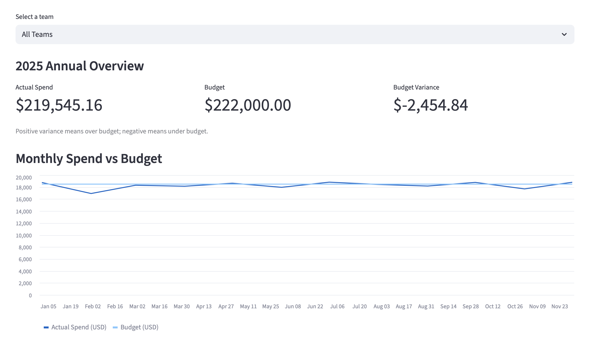

# Cloud Spend Analytics and AI Reporting

A financial analytics portfolio project that helps Finance and
Engineering teams monitor cloud spending, compare costs with budgets,
investigate spending spikes, and evaluate forecasts.

Built with Python, SQL, DuckDB, and Streamlit using simulated data.

## Business Questions

- How much did each team and service spend?
- Which teams exceeded their monthly budgets?
- Which daily charges warrant investigation?
- How accurately can a weekly baseline predict next month's spending?

## Dashboard Preview



## What I Built

- SQL analyses for monthly spending, month-over-month changes,
  and budget variances.
- An interactive Streamlit dashboard with team filters and charts.
- Data quality checks and reconciliation between daily records
  and monthly reporting totals.
- A rule-based detector comparing spending with the previous
  eight observations from the same weekday.
- A seasonal naive forecast evaluated on December 2025.
- An AI-assisted monthly narrative reviewed against source metrics.
- A standalone HTML report with an embedded chart.

## Results

- Analyzed 3,285 simulated daily records across three teams
  and three cloud service categories.
- Reconciled annual spending of USD 219,545.16 between daily
  records and monthly reporting totals.
- Identified December spending of USD 18,809.78 against a
  USD 18,500.00 budget: an overrun of USD 309.78, or 1.67%.
- Detected the single injected ML Compute spending spike
  in a separate demonstration dataset.

### December Forecast Evaluation

Predictions used only data available through November 30, 2025.

| Team | Daily MAE (USD) | WAPE |
|---|---:|---:|
| Data | 7.12 | 5.29% |
| Engineering | 9.44 | 4.71% |
| ML | 10.13 | 3.73% |

## Scope and Limitations

- All spending and budgets are simulated.
- Anomaly detection was demonstrated with one injected spike;
  broader detection performance has not been established.
- Forecast accuracy was measured on one holdout month.
  The current forecast is a simple weekly baseline, not a trained ML model.
- The AI narrative was generated manually in an AI chat and
  checked against the input JSON. No AI API is connected.
- The saved report covers December 2025 and all teams;
  it does not respond to dashboard filters.
- The application has been run locally; production deployment
  and scalability have not been tested.

## Local Setup

Developed locally on macOS with Python 3.9.6.
Other environments have not yet been tested.

Open a terminal in the project folder.

### 1. Create and activate a virtual environment

```bash
python3 -m venv .venv
source .venv/bin/activate
```

### 2. Install dependencies

```bash
python -m pip install -r requirements.txt
```

### 3. Generate data and analysis outputs

Run these commands in order:

```bash
python generate_data.py
python generate_budget.py
python analyze_costs.py
python analyze_budget.py
python validate_data.py
python create_anomaly_scenario.py
python detect_anomalies.py
python forecast_costs.py
python prepare_ai_report.py
```

The anomaly detector reads the separate simulated scenario.
The spending and forecast analyses use the original simulated data.

### 4. Export the saved report

Ensure the reviewed Markdown report exists at
`reports/2025-12_cloud_spend_report.md`, then run:

```bash
python export_report.py
```

The AI narrative was generated manually and saved in the repository.
The scripts do not generate or update the narrative automatically.
If the input data changes, regenerate and review the narrative
before exporting the report again.

### 5. Launch the dashboard

```bash
python -m streamlit run app.py
```

Open the Local URL printed in the terminal.
To stop the application, press Control+C in that terminal.

